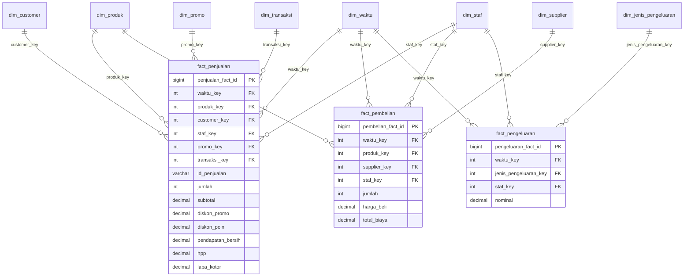

# Konsep UAS Data Warehouse — Sistem Monitoring Transaksi Keuangan dan Persediaan UMKM Pakaian

> Dokumen kerja Kelompok F (lanjutan proyek UTS Basis Data).
> Tujuannya: semua anggota paham **apa yang dikerjakan, kenapa, di mana, dan pakai apa** dari awal sampai laporan UAS selesai.

---

## Daftar Isi

0. [Cara membaca dokumen ini](#0-cara-membaca-dokumen-ini)
1. [Pemahaman dasar (baca dulu sebelum apa pun)](#1-pemahaman-dasar)
2. [Gambaran besar arsitektur: apa masuk ke mana, connect ke mana](#2-gambaran-besar-arsitektur)
3. [Alat dan persiapan](#3-alat-dan-persiapan)
4. [Tahap 0 — Hal yang harus dikonfirmasi ke asprak](#4-tahap-0--konfirmasi-ke-asprak)
5. [Tahap 1 — Merapikan database UTS (OLTP) dan mengisi data dummy](#5-tahap-1--merapikan-database-uts-oltp)
6. [Tahap 2 — Merancang Data Warehouse (star schema)](#6-tahap-2--merancang-data-warehouse-star-schema)
7. [Tahap 3 — ETL (mengisi DW dari database UTS)](#7-tahap-3--etl)
8. [Tahap 4 — OLAP (cube dan query analisis)](#8-tahap-4--olap)
9. [Tahap 5 — Dashboard analitik di website Laravel](#9-tahap-5--dashboard-analitik-di-laravel)
10. [Tahap 6 — Pengujian](#10-tahap-6--pengujian)
11. [Struktur laporan UAS](#11-struktur-laporan-uas)
12. [Pembagian tugas dan urutan kerja](#12-pembagian-tugas-dan-urutan-kerja)
13. [Kemungkinan pertanyaan asprak/dosen dan jawabannya](#13-kemungkinan-pertanyaan-asprakdosen-dan-jawabannya)
14. [Glosarium](#14-glosarium)

---

## 0. Cara membaca dokumen ini

- **Bagian 1–2** wajib dibaca semua anggota. Ini fondasi; tanpa ini bagian lain akan membingungkan.
- **Bagian 3–10** adalah langkah kerja berurutan. Tiap tahap punya: *apa itu*, *kenapa*, *apa yang dikerjakan*, *hasilnya apa*.
- **Bagian 11** memetakan pekerjaan ke bab laporan (mengikuti pola laporan kating Kelompok 4 dan Kelompok 6).
- **Bagian 13** untuk persiapan ditanya asprak/dosen.

Sumber dokumen ini:
- Proposal UTS kalian (`Kelompok F_Basis Data_SD A1 (2).pdf`) dan kode Laravel di repo ini (13 tabel di `database/migrations`).
- Laporan UAS kating: **Kelompok 4 (Study Buddy)** dan **Kelompok 6 (SIMAS-FTMM)**. Keduanya: Laravel + MySQL untuk website, database Data Warehouse terpisah berbentuk star schema, ETL (Kelompok 4 jelas memakai **Pentaho**), OLAP berupa *cube*, lalu dashboard analitik di Laravel yang membaca dari DW.

> Yang ditandai **⚠ Konfirmasi** adalah hal yang tidak bisa dipastikan dari dokumen dan harus ditanyakan ke asprak.

---

## 1. Pemahaman dasar

### 1.1 Masalahnya apa?

Di UTS kalian sudah membuat **sistem transaksi**: customer belanja online, kasir jualan offline lewat POS, admin kelola produk, pembelian dari supplier, promo, poin, dan pengeluaran. Semua tersimpan di **satu database** (13 tabel).

Database itu bagus untuk **mencatat** transaksi, tapi kurang cocok untuk **menganalisis**, misalnya:

- "Kategori apa yang omzetnya naik tiap bulan selama 2026?"
- "Ukuran dan warna apa yang paling laku untuk kemeja?"
- "Promo mana yang paling banyak mendongkrak penjualan?"
- "Online atau offline yang lebih menguntungkan per kuartal?"

Untuk menjawab itu dari database UTS, query-nya harus join 5–7 tabel, menghitung ulang setiap kali, dan memperlambat database yang sedang dipakai kasir. **Data Warehouse** dibuat untuk menyelesaikan masalah ini.

### 1.2 Dua database: OLTP dan Data Warehouse

| | **Database 1 — OLTP (database UTS)** | **Database 2 — Data Warehouse (DW)** |
|---|---|---|
| Kepanjangan | Online Transaction Processing | — |
| Fungsi | **Mencatat dan mengubah** data sehari-hari | **Menganalisis** data historis |
| Dipakai oleh | Customer, kasir, admin (halaman-halaman website UTS) | Dashboard analitik, query OLAP |
| Operasi utama | INSERT, UPDATE, DELETE kecil-kecil tapi sering | SELECT besar (SUM, COUNT, GROUP BY) |
| Bentuk tabel | Ternormalisasi (13 tabel saling berelasi) | **Star schema**: tabel fakta di tengah, tabel dimensi di sekeliling |
| Isi | Kondisi terkini (stok sekarang, status pesanan sekarang) | Riwayat (semua transaksi dari waktu ke waktu) |
| Diisi oleh | Aplikasi Laravel | **ETL** (bukan oleh user, bukan oleh aplikasi) |
| Contoh nama | `umkm` (nama database UTS kalian) | `umkm_dw` |

**Analogi toko:**
- OLTP = **meja kasir dan gudang toko**. Ramai, dipakai terus, isinya berubah tiap menit.
- DW = **ruang arsip dan analisis pemilik toko**. Isinya salinan rapi dari catatan kasir, disusun supaya mudah dihitung. Tidak ada yang "berjualan" di ruang ini.
- ETL = **petugas yang tiap malam menyalin catatan kasir ke ruang arsip** sambil merapikannya.
- OLAP = **cara pemilik membaca arsip**: dijumlah per bulan, dipecah per kategori, disaring hanya online, dst.
- Dashboard = **papan grafik** di dinding yang menampilkan hasil bacaan tadi.

### 1.3 Istilah inti (versi singkat)

| Istilah | Arti sederhana | Contoh di proyek kita |
|---|---|---|
| **Star schema** | Bentuk tabel DW: 1 tabel fakta di tengah, dikelilingi tabel dimensi seperti bintang | `fact_penjualan` di tengah, dikelilingi `dim_waktu`, `dim_produk`, `dim_customer`, ... |
| **Tabel fakta** | Menyimpan **kejadian yang bisa diukur** (angka) | Tiap baris = 1 item yang terjual |
| **Measure** | Kolom angka di tabel fakta yang bisa dijumlah/dirata-rata | `jumlah`, `pendapatan_bersih`, `laba_kotor` |
| **Tabel dimensi** | Menyimpan **konteks/sudut pandang** untuk membaca fakta | Kapan (`dim_waktu`), apa (`dim_produk`), siapa (`dim_customer`) |
| **Grain** | "1 baris fakta itu mewakili apa?" — harus diputuskan paling awal | 1 baris `fact_penjualan` = 1 varian dalam 1 transaksi penjualan berhasil |
| **Surrogate key** | ID angka baru buatan DW (1, 2, 3, ...) untuk tabel dimensi | `produk_key = 17` mewakili `id_varian = 'VAR001'` |
| **Natural key** | ID asli dari database UTS | `id_varian`, `id_akun`, `id_promo` |
| **ETL** | Extract–Transform–Load: ambil data dari OLTP, rapikan, masukkan ke DW | Lihat Bagian 7 |
| **OLAP** | Cara menganalisis DW dari banyak sudut: roll-up, drill-down, slice, dice, pivot | Lihat Bagian 8 |
| **Cube** | Definisi OLAP: fakta mana + dimensi apa + measure apa + hierarki apa | Cube "Penjualan" dibuat di Schema Workbench |

### 1.4 ETL vs OLAP (yang sering tertukar)

- **ETL = membangun/mengisi gudang.** Dijalankan sekali per periode refresh (mis. tiap malam atau manual sebelum demo). Perhitungan di ETL bersifat **tetap per baris**, misalnya `subtotal = jumlah × harga_satuan`.
- **OLAP = menganalisis isi gudang.** Dijalankan setiap kali ada pertanyaan. Pengelompokannya **fleksibel**: dijumlah per bulan, per kategori, per kanal — tanpa ETL ulang.
- Kalau semua penjumlahan dikerjakan di ETL, kita harus menyiapkan tabel untuk setiap kemungkinan pertanyaan. Karena itu ETL cukup menyimpan **data rinci** (sesuai grain), lalu OLAP yang meringkas saat dibaca.
- **Visualisasi (grafik) bukan OLAP.** OLAP menghasilkan angka/tabel ringkasan; dashboard yang menggambar grafiknya.

Urutan seluruh UAS:

```
Star schema (rancang rak kosong)
      ↓
ETL (isi rak dari database UTS)
      ↓
OLAP (tanya & analisis isi rak)
      ↓
Dashboard (tampilkan jawabannya sebagai grafik)
```

---

## 2. Gambaran besar arsitektur

### 2.1 Diagram alur data

```
 ┌───────────────────────────── WEBSITE LARAVEL (satu aplikasi, sama seperti UTS) ─────────────────────────────┐
 │                                                                                                             │
 │  Halaman Customer / Kasir / Admin (UTS)                       Halaman baru: Dashboard Analitik (Admin)      │
 │   koneksi Laravel: "mysql"                                     koneksi Laravel: "dw"                         │
 │        │  baca + tulis                                                ▲  baca saja                           │
 └────────┼──────────────────────────────────────────────────────────────┼─────────────────────────────────────┘
          ▼                                                              │
 ┌──────────────────────┐        ┌──────────────────────────┐   ┌───────┴──────────────┐   ┌──────────────────────┐
 │ DB 1: umkm      │ ─────► │ ETL (Pentaho Spoon)      │ ─►│ DB 2: umkm_dw        │◄──│ OLAP                 │
 │ 13 tabel UTS         │ Extract│ Transform: join, hitung, │Load│ dim_* dan fact_*     │   │ (Schema Workbench:   │
 │ (sumber data)        │        │ bersihkan, cari key      │   │ (star schema)        │   │  cube, measure)      │
 └──────────────────────┘        └──────────────────────────┘   └──────────────────────┘   └──────────────────────┘
```

### 2.2 Tabel "siapa connect ke mana" (ini yang biasanya ditanya asprak)

| Komponen | Terhubung ke | Arah | Untuk apa |
|---|---|---|---|
| Halaman customer, kasir, admin (fitur UTS) | **DB OLTP** (`umkm`) | baca + tulis | Transaksi sehari-hari |
| Laporan lama di UTS (`/admin/laporan`, `ReportController`) | **DB OLTP** | baca | Laporan operasional (kondisi saat ini) — tetap dipertahankan |
| **ETL – langkah Extract (Table Input di Spoon)** | **DB OLTP** | baca | Mengambil data mentah |
| **ETL – langkah Load (Table Output / Dimension lookup di Spoon)** | **DB DW** (`umkm_dw`) | tulis | Mengisi dimensi dan fakta |
| **Cube OLAP (Schema Workbench)** | **DB DW** | baca | Mendefinisikan dimensi, hierarki, measure |
| **Dashboard Analitik Laravel** (halaman baru) | **DB DW** (koneksi `dw`) | baca | Grafik dan analisis |

Hal penting:
- **DB OLTP dan DB DW tidak saling terhubung langsung.** Tidak ada foreign key antar-database. Satu-satunya jembatan adalah **ETL**, dan arahnya **satu arah** (OLTP → DW).
- **DW tidak diedit manual** dan tidak diubah oleh website. Kalau data di OLTP berubah, DW baru ikut berubah setelah ETL dijalankan lagi.
- **Website tetap satu** (Laravel UTS). Yang ditambah hanya satu koneksi database dan halaman dashboard analitik.
- Kedua database boleh berada di **satu server MySQL yang sama** (beda nama database). Ini yang paling sederhana untuk tugas.

---

## 3. Alat dan persiapan

### 3.1 Daftar alat

| Alat | Fungsi | Catatan |
|---|---|---|
| **MySQL Server** (Community) | Menyimpan DB OLTP dan DB DW | Karena tidak memakai Laragon lagi, MySQL dipasang sendiri. ⚠ Konfirmasi versi ke asprak |
| **MySQL Workbench** | Melihat tabel, menjalankan SQL, membuat diagram (EER) | Bisa dipakai untuk screenshot star schema dan hasil query |
| **PHP + Composer** | Menjalankan Laravel | Sama seperti UTS. Tanpa Laragon, PHP perlu dipasang terpisah dan ditambahkan ke PATH |
| **Node.js + npm** | Build asset frontend (Vite) | Sama seperti UTS |
| **Java (JDK/JRE)** | Wajib untuk menjalankan Pentaho | ⚠ Konfirmasi versi Java yang cocok dengan versi Pentaho yang dipakai kelas |
| **Pentaho Data Integration (Spoon)** | Membuat dan menjalankan **ETL** secara visual | Kelompok 4 kating memakai Pentaho untuk ETL |
| **Pentaho Schema Workbench** | Membuat **cube OLAP** (file skema XML/Mondrian) | ⚠ Konfirmasi: nama "Spoon" dan "Schema Workbench" dari info asprak; tidak tertulis eksplisit di laporan kating |
| **MySQL JDBC Driver** (`mysql-connector-j-*.jar`) | Supaya Spoon dan Schema Workbench bisa connect ke MySQL | Disalin ke folder `lib` (Spoon) dan `drivers` (Schema Workbench) |
| **Chart.js** | Grafik di dashboard Laravel | Lewat CDN atau npm |

### 3.2 Checklist persiapan (centang satu per satu)

- [ ] MySQL Server terpasang dan berjalan, bisa login dari MySQL Workbench.
- [ ] Database `umkm` dibuat; `.env` Laravel diarahkan ke MySQL (bukan sqlite).
  > Catatan: di repo saat ini `.env.example` masih `DB_CONNECTION=sqlite` dan file `.env` tidak ada di repo. Tiap anggota harus membuat `.env` sendiri.
- [ ] `php artisan migrate --seed` berhasil di MySQL.
- [ ] Website UTS bisa jalan (`php artisan serve` dan `npm run dev`).
- [ ] Database `umkm_dw` dibuat (kosong dulu).
- [ ] Java terpasang (`java -version` jalan di terminal).
- [ ] Pentaho Spoon bisa dibuka; koneksi ke `umkm` dan `umkm_dw` berhasil di-*Test*.
- [ ] Schema Workbench bisa dibuka; koneksi ke `umkm_dw` berhasil.

Contoh `.env` (bagian database):

```dotenv
# Database 1: OLTP (database UTS)
DB_CONNECTION=mysql
DB_HOST=127.0.0.1
DB_PORT=3306
DB_DATABASE=umkm
DB_USERNAME=root
DB_PASSWORD=

# Database 2: Data Warehouse
DB_DW_HOST=127.0.0.1
DB_DW_PORT=3306
DB_DW_DATABASE=umkm_dw
DB_DW_USERNAME=root
DB_DW_PASSWORD=
```

---

## 4. Tahap 0 — Konfirmasi ke asprak

Tanyakan ini **sebelum** mulai, karena jawabannya mengubah cara kerja:

1. **Alat ETL dan OLAP wajib Pentaho (Spoon + Schema Workbench)?** Atau boleh ETL lewat SQL/script (mis. Artisan command Laravel)?
2. **Versi Pentaho dan Java** yang disarankan (supaya semua anggota sama).
3. **Hasil cube OLAP ditampilkan di mana?** Cukup screenshot skema + query SQL, atau harus dibuka di aplikasi OLAP viewer tertentu (mis. Pentaho Server/Saiku)?
4. **Minimal jumlah tabel fakta dan dimensi?** (Kating: Kelompok 4 punya 3 fakta, Kelompok 6 punya 3 fakta + 4 dimensi.)
5. **Minimal jumlah data dummy** (berapa bulan / berapa transaksi)?
6. **Dashboard harus di Laravel**, atau boleh tool BI lain?
7. **Format laporan**: mengikuti struktur bab kating (Bab I–IX) atau ada template baru?
8. Pertanyaan "**ini masuk ke mana, connect ke mana**" itu nanti saat presentasi/demo atau di laporan?

---

## 5. Tahap 1 — Merapikan database UTS (OLTP)

### 5.1 Kenapa harus dirapikan dulu?

DW hanya bisa menjawab pertanyaan yang **datanya tercatat** di OLTP. Setelah memeriksa migrasi dan kode Laravel kalian, ada beberapa informasi penting untuk analisis yang **belum tersimpan**.

### 5.2 Temuan dari database dan kode UTS

| # | Temuan | Bukti di kode | Dampak ke DW |
|---|---|---|---|
| 1 | `detail_penjualan.harga_satuan` menyimpan harga **setelah** diskon promo; harga normal dan promo yang dipakai **tidak disimpan** | `PricingService::variant()` menghitung `unit_price = harga_jual × (1 − diskon/100)`, lalu `SaleService` menyimpannya ke `harga_satuan` | Tidak bisa analisis efektivitas promo secara akurat. Kalau `harga_jual` produk berubah, harga normal masa lalu hilang |
| 2 | Promo aktif dipilih dari **diskon terbesar** yang berlaku saat itu, tapi `id_promo`-nya tidak dicatat | `PricingService::activeDiscount()` memakai `max('pr.persen_diskon')` | ETL harus menebak promo dari tanggal transaksi (kurang akurat jika ada promo tumpang-tindih) |
| 3 | Stok hanya angka terkini di `varian_produk.stok`; **tidak ada riwayat** perubahan stok | Tidak ada tabel mutasi/log stok | Tidak bisa analisis persediaan dari waktu ke waktu (hanya bisa snapshot saat ETL dijalankan) |
| 4 | `penjualan.id_akun` artinya **berbeda** tergantung kanal: ONLINE = customer, OFFLINE = kasir. Customer offline (member) ada di `penjualan_member` | Proposal UTS Tabel 3.2 dan migrasi `penjualan_member` | Bukan kesalahan, tapi ETL harus memisahkan dengan benar ke `dim_customer` dan `dim_staf` (lihat 7.4) |
| 5 | Pembelian hanya punya `tanggal_pembelian`; tidak ada tanggal kapan barang **diterima** | Migrasi `pembelian_produk` | Analisis lama pengiriman supplier tidak bisa (opsional) |
| 6 | Data seeder masih data demo kecil | `database/seeders/PrototypeSeeder.php` | DW dengan data sedikit tidak menunjukkan tren apa pun |

### 5.3 Perbaikan yang disarankan

Dibuat sebagai **migrasi baru** (jangan mengedit migrasi lama, supaya riwayat perubahan jelas di laporan).

**Wajib:**

1. **Tambah kolom di `detail_penjualan`:**
   - `harga_normal DECIMAL(12,2)` — harga jual sebelum diskon promo.
   - `persen_diskon DECIMAL(5,2) DEFAULT 0` — diskon promo yang dipakai.
   - `id_promo VARCHAR NULL` (FK ke `promo`) — promo yang dipakai, `NULL` jika tidak ada promo.
   - Ubah `PricingService` agar mengembalikan `id_promo` yang terpilih, lalu `SaleService` menyimpan ketiga kolom ini.
2. **Data dummy yang banyak dan realistis** (lihat 5.4).

**Disarankan (nilai tambah):**

3. **Tabel `mutasi_stok`** (kartu stok): `id_mutasi, id_varian, tanggal, jenis (MASUK/KELUAR/PENYESUAIAN), jumlah, stok_sesudah, referensi (id_pembelian/id_penjualan)`. Diisi otomatis ketika pembelian DITERIMA dan pembayaran BERHASIL. Ini membuat analisis persediaan historis jadi mungkin.
4. **`pembelian_produk.tanggal_diterima DATETIME NULL`** — diisi saat status berubah ke DITERIMA.

> Jika waktu terbatas, kerjakan poin 1 dan 2 saja. Poin 3 bisa diganti dengan *snapshot stok* di DW (lihat `fact_stok_snapshot`, opsional).

### 5.4 Data dummy (seeder)

**Kenapa:** analisis DW (tren, perbandingan, musiman) hanya bermakna jika datanya banyak dan tersebar dalam waktu.

**Target (⚠ Konfirmasi minimal ke asprak):**

| Data | Jumlah usulan |
|---|---|
| Rentang waktu transaksi | 12 bulan (mis. Januari–Desember 2026) |
| Kategori | 5–6 (Kaos, Kemeja, Celana, Jaket, Dress, Aksesoris) |
| Produk | 30–50 |
| Varian per produk | 4–12 (ukuran S–XXL × 2–3 warna) |
| Supplier | 5–8 |
| Customer | 150–300 |
| Kasir | 3–4, Admin 1–2 |
| Promo | 8–12 (sebagian tumpang-tindih periode) |
| Penjualan | 2.000–5.000 transaksi (± 1–4 item per transaksi) |
| Pembelian | 60–150 transaksi |
| Pengeluaran operasional | rutin bulanan (listrik, internet, sewa) + insidental |

**Aturan supaya data masuk akal (penting, karena DW akan menampilkan polanya):**
- Pembelian (restock) terjadi **sebelum** penjualan varian tersebut; stok tidak boleh minus.
- Ada pola: akhir pekan lebih ramai; bulan tertentu (mis. menjelang Lebaran, akhir tahun) lebih tinggi; ukuran M/L lebih laku dari XXL.
- Campuran kanal: mis. 55% offline, 45% online; offline ada member dan guest.
- Sebagian kecil transaksi **GAGAL/BATAL** (supaya ETL punya data yang harus disaring).
- Penjualan saat periode promo memakai harga diskon dan mencatat `id_promo`.
- Pengeluaran `PEMBELIAN_PRODUK` hanya untuk pembelian berstatus `DITERIMA` (sesuai aturan UTS).

**Hasil tahap 1:** database UTS sudah lengkap kolomnya dan berisi data ribuan transaksi selama 12 bulan.

---

## 6. Tahap 2 — Merancang Data Warehouse (star schema)

### 6.1 Langkah merancang (urutan Kimball)

1. **Pilih proses bisnis** yang mau dianalisis.
2. **Tentukan grain** (1 baris fakta = apa).
3. **Tentukan dimensi** (sudut pandang).
4. **Tentukan measure** (angka yang diukur).

### 6.2 Pertanyaan bisnis yang mau dijawab

Ini dasar rancangan. Setiap tabel dan kolom DW harus bisa ditelusuri ke salah satu pertanyaan ini.

| Kode | Pertanyaan | Fakta yang dipakai |
|---|---|---|
| Q1 | Berapa omzet dan laba kotor per bulan/kuartal/tahun? | fact_penjualan |
| Q2 | Kategori dan produk apa yang paling laku (jumlah dan nilai)? | fact_penjualan |
| Q3 | Ukuran dan warna apa yang paling laku per kategori? | fact_penjualan |
| Q4 | Perbandingan kanal online vs offline, dan metode bayar QR vs tunai | fact_penjualan |
| Q5 | Seberapa efektif promo: penjualan saat promo vs tanpa promo, total diskon yang diberikan | fact_penjualan |
| Q6 | Siapa customer paling aktif / nilai belanja terbesar? Berapa porsi member vs guest? | fact_penjualan |
| Q7 | Kinerja kasir: jumlah transaksi dan omzet yang ditangani | fact_penjualan |
| Q8 | Hari apa dalam seminggu yang paling ramai? | fact_penjualan |
| Q9 | Berapa biaya pembelian per supplier dan per kategori produk? | fact_pembelian |
| Q10 | Komposisi pengeluaran per jenis per bulan | fact_pengeluaran |
| Q11 | Arus kas: pemasukan − pengeluaran per bulan | fact_penjualan + fact_pengeluaran |
| Q12 | (opsional) Varian mana yang sering di bawah stok minimum? | fact_stok_snapshot |

### 6.3 Bus matrix (fakta × dimensi)

Bus matrix menunjukkan dimensi mana dipakai oleh fakta mana. Dimensi yang dipakai beberapa fakta (mis. `dim_waktu`, `dim_produk`) disebut **conformed dimension**.

| Fakta \ Dimensi | dim_waktu | dim_produk | dim_customer | dim_staf | dim_promo | dim_transaksi | dim_supplier | dim_jenis_pengeluaran |
|---|:-:|:-:|:-:|:-:|:-:|:-:|:-:|:-:|
| **fact_penjualan** | ✔ | ✔ | ✔ | ✔ (kasir) | ✔ | ✔ | | |
| **fact_pembelian** | ✔ | ✔ | | ✔ (admin) | | | ✔ | |
| **fact_pengeluaran** | ✔ | | | ✔ (admin) | | | | ✔ |
| fact_stok_snapshot *(opsional)* | ✔ | ✔ | | | | | | |

> Secara teknis ini disebut **galaxy schema / fact constellation** (beberapa star schema yang berbagi dimensi). Di laporan tetap boleh disebut "star schema" per fakta, seperti Kelompok 4 yang menggambar satu diagram bintang per fakta.

### 6.4 Tabel fakta

#### 6.4.1 `fact_penjualan` (fakta utama)

- **Proses bisnis:** penjualan (online + offline).
- **Grain:** **1 baris = 1 varian produk dalam 1 transaksi penjualan yang pembayarannya BERHASIL dan tidak BATAL** (= 1 baris `detail_penjualan` yang valid).
- **Sumber:** `penjualan` + `detail_penjualan` (+ `penjualan_member`, `varian_produk`, `produk`).

| Kolom | Tipe | Jenis | Isi / rumus |
|---|---|---|---|
| `penjualan_fact_id` | BIGINT PK AI | — | ID baris fakta |
| `waktu_key` | INT FK | dimensi | `YYYYMMDD` dari `penjualan.tanggal_penjualan` |
| `produk_key` | INT FK | dimensi | Lookup `dim_produk` dengan `id_varian` |
| `customer_key` | INT FK | dimensi | Lookup `dim_customer`; **0 = guest / non-member** |
| `staf_key` | INT FK | dimensi | Lookup `dim_staf` (kasir); **0 = tidak ada (online)** |
| `promo_key` | INT FK | dimensi | Lookup `dim_promo`; **0 = tanpa promo** |
| `transaksi_key` | INT FK | dimensi | Lookup `dim_transaksi` dengan (kanal, metode bayar) |
| `id_penjualan` | VARCHAR | *degenerate dimension* | Nomor transaksi asli (untuk hitung jumlah transaksi & penelusuran) |
| `id_detail_penjualan` | VARCHAR UNIQUE | penelusuran | Mencegah data dobel saat ETL diulang |
| `jumlah` | INT | measure | `detail_penjualan.jumlah` |
| `harga_normal` | DECIMAL | measure | `detail_penjualan.harga_normal` (kolom baru) |
| `harga_satuan` | DECIMAL | measure | Harga setelah promo |
| `diskon_promo` | DECIMAL | measure | `(harga_normal − harga_satuan) × jumlah` |
| `subtotal` | DECIMAL | measure | `harga_satuan × jumlah` |
| `diskon_poin` | DECIMAL | measure | Alokasi `penjualan.diskon_poin` ke item secara proporsional: `diskon_poin × subtotal / total_subtotal_transaksi` |
| `pendapatan_bersih` | DECIMAL | measure | `subtotal − diskon_poin` |
| `hpp` | DECIMAL | measure | Harga pokok: `rata-rata harga beli varian × jumlah` (lihat 7.4) |
| `laba_kotor` | DECIMAL | measure | `pendapatan_bersih − hpp` |

Kenapa grain-nya per item (bukan per transaksi)? Karena pertanyaan Q2, Q3, Q5 butuh rincian produk/varian. Jumlah transaksi tetap bisa dihitung dengan `COUNT(DISTINCT id_penjualan)`.

#### 6.4.2 `fact_pembelian`

- **Proses bisnis:** restock produk dari supplier.
- **Grain:** **1 baris = 1 varian dalam 1 pembelian berstatus DITERIMA** (= 1 baris `detail_pembelian`).
- **Sumber:** `pembelian_produk` + `detail_pembelian`.

| Kolom | Tipe | Jenis | Isi |
|---|---|---|---|
| `pembelian_fact_id` | BIGINT PK AI | — | |
| `waktu_key` | INT FK | dimensi | Dari `tanggal_pembelian` (atau `tanggal_diterima` jika ditambahkan) |
| `produk_key` | INT FK | dimensi | Lookup `id_varian` |
| `supplier_key` | INT FK | dimensi | Lookup `id_supplier` |
| `staf_key` | INT FK | dimensi | Admin pencatat (`pembelian_produk.id_akun`) |
| `id_pembelian` | VARCHAR | degenerate | |
| `id_detail_pembelian` | VARCHAR UNIQUE | penelusuran | |
| `jumlah` | INT | measure | |
| `harga_beli` | DECIMAL | measure | `detail_pembelian.harga_satuan` |
| `total_biaya` | DECIMAL | measure | `jumlah × harga_beli` |

#### 6.4.3 `fact_pengeluaran`

- **Proses bisnis:** arus kas keluar.
- **Grain:** **1 baris = 1 catatan pengeluaran** (= 1 baris tabel `pengeluaran`).

| Kolom | Tipe | Jenis | Isi |
|---|---|---|---|
| `pengeluaran_fact_id` | BIGINT PK AI | — | |
| `waktu_key` | INT FK | dimensi | Dari `tanggal_pengeluaran` |
| `jenis_pengeluaran_key` | INT FK | dimensi | Lookup `jenis_pengeluaran` |
| `staf_key` | INT FK | dimensi | Admin pencatat |
| `id_pengeluaran` | VARCHAR UNIQUE | degenerate | |
| `nominal` | DECIMAL | measure | |

> **Hati-hati menghitung ganda.** Pengeluaran berjenis `PEMBELIAN_PRODUK` nilainya sama dengan total `fact_pembelian` untuk pembelian yang sama. Jadi:
> - **Arus kas** = `SUM(fact_penjualan.pendapatan_bersih) − SUM(fact_pengeluaran.nominal)` (semua jenis).
> - **Laba kotor** = `SUM(fact_penjualan.laba_kotor)` (pakai HPP, bukan pengeluaran pembelian).
> - Jangan menjumlah `fact_pembelian` dan `fact_pengeluaran` bersamaan.

#### 6.4.4 `fact_stok_snapshot` (opsional / nilai tambah)

- **Jenis:** *periodic snapshot* (berbeda dari 3 fakta di atas yang berjenis *transaction*).
- **Grain:** **1 baris = kondisi stok 1 varian pada 1 tanggal ETL dijalankan.**
- Kolom: `waktu_key`, `produk_key`, `stok`, `stok_minimum`, `is_low_stock (stok ≤ stok_minimum)`.
- Kelemahan: riwayat hanya ada sejak ETL mulai dijalankan rutin. Jika tabel `mutasi_stok` dibuat (5.3 poin 3), snapshot masa lalu bisa direkonstruksi.

### 6.5 Tabel dimensi

Aturan umum semua dimensi:
- Punya **surrogate key** (`*_key`, INT) sebagai PK, dan **natural key** dari OLTP (`id_*`) untuk lookup saat ETL.
- Didenormalisasi: data yang di OLTP tersebar di beberapa tabel digabung jadi satu (mis. kategori masuk ke `dim_produk`).
- Punya baris **"tidak diketahui/tidak ada"** dengan key `0`, supaya fakta tidak pernah berisi NULL di kolom key.
- Strategi perubahan data: **SCD Type 1** (data lama ditimpa jika berubah), cukup untuk tugas ini. *(Nilai tambah: jelaskan SCD Type 2 di laporan sebagai pengembangan.)*

#### `dim_waktu`

Tidak diambil dari OLTP, tapi **dibangkitkan** untuk setiap tanggal dalam rentang data (mis. 2025-01-01 s.d. 2027-12-31). Kating Kelompok 4 membuatnya di Pentaho dengan langkah *Generate Rows*.

| Kolom | Contoh | Keterangan |
|---|---|---|
| `waktu_key` (PK) | 20260315 | Format `YYYYMMDD` |
| `tanggal` | 2026-03-15 | |
| `hari` | 15 | |
| `nama_hari` | Minggu | |
| `hari_dalam_minggu` | 7 | 1 = Senin |
| `is_akhir_pekan` | 1 | Sabtu/Minggu |
| `minggu_dalam_tahun` | 11 | |
| `bulan` | 3 | |
| `nama_bulan` | Maret | |
| `kuartal` | 1 | |
| `semester` | 1 | |
| `tahun` | 2026 | |

Hierarki: **Tahun → Semester → Kuartal → Bulan → Tanggal**.

#### `dim_produk` (level varian)

| Kolom | Sumber OLTP |
|---|---|
| `produk_key` (PK) | dibuat DW |
| `id_varian` (natural key, UNIQUE) | `varian_produk.id_varian` |
| `ukuran`, `warna` | `varian_produk` |
| `stok_minimum` | `varian_produk` |
| `id_produk`, `nama_produk`, `harga_jual`, `status_produk` | `produk` |
| `id_kategori`, `nama_kategori` | `kategori_produk` |

Hierarki: **Kategori → Produk → Varian (ukuran/warna)**.

#### `dim_customer`

| Kolom | Sumber |
|---|---|
| `customer_key` (PK) | dibuat DW; **0 = "GUEST / Non-member"** |
| `id_akun` (natural key) | `akun.id_akun` dengan `tipe_akun = 'CUSTOMER'` |
| `nama`, `username`, `status_akun` | `akun` |
| `tanggal_daftar`, `tahun_daftar` | `akun.created_at` |

#### `dim_staf`

| Kolom | Sumber |
|---|---|
| `staf_key` (PK) | dibuat DW; **0 = "Tidak ada (transaksi online)"** |
| `id_akun` (natural key) | `akun` dengan `tipe_akun IN ('KASIR','ADMIN')` |
| `nama`, `peran` (KASIR/ADMIN), `status_akun` | `akun` |

#### `dim_promo`

| Kolom | Sumber |
|---|---|
| `promo_key` (PK) | dibuat DW; **0 = "Tanpa promo"** |
| `id_promo` (natural key) | `promo.id_promo` |
| `nama_promo`, `persen_diskon`, `tanggal_mulai`, `tanggal_selesai` | `promo` |
| `durasi_hari` | transform: `DATEDIFF(tanggal_selesai, tanggal_mulai) + 1` |
| `kelompok_diskon` | transform: mis. `≤10%`, `11–25%`, `>25%` |

#### `dim_transaksi` (*junk dimension*)

Menggabungkan atribut kecil dengan sedikit nilai, supaya fakta tidak punya banyak kolom teks. Isinya semua kombinasi:

| `transaksi_key` | `kanal_penjualan` | `metode_pembayaran` |
|---|---|---|
| 1 | ONLINE | QR |
| 2 | ONLINE | TUNAI |
| 3 | OFFLINE | QR |
| 4 | OFFLINE | TUNAI |

Hierarki: **Kanal → Metode bayar**.

#### `dim_supplier`

`supplier_key` (PK), `id_supplier` (natural key), `nama_supplier`, `alamat`.

#### `dim_jenis_pengeluaran`

| `jenis_pengeluaran_key` | `jenis_pengeluaran` | `kelompok` |
|---|---|---|
| 1 | PEMBELIAN_PRODUK | PEMBELIAN STOK |
| 2 | LISTRIK | OPERASIONAL |
| 3 | INTERNET | OPERASIONAL |
| 4 | SEWA | OPERASIONAL |
| 5 | ONGKIR | OPERASIONAL |
| 6 | PERAWATAN | OPERASIONAL |
| 7 | LAINNYA | OPERASIONAL |

Sumbernya adalah daftar enum di migrasi `pengeluaran`, jadi dimensi ini bisa diisi sekali (statis).

### 6.6 Diagram star schema



Untuk laporan, gambar ulang diagram ini di MySQL Workbench (*Database → Reverse Engineer* dari `umkm_dw`) atau draw.io. Ikuti pola Kelompok 4: **satu gambar star schema per tabel fakta**, ditambah satu gambar gabungan.

### 6.7 DDL lengkap database DW (MySQL)

Jalankan di MySQL Workbench. Sumber kebenaran struktur DW; bisa juga dibuat sebagai migrasi Laravel di koneksi `dw`.

```sql
CREATE DATABASE IF NOT EXISTS umkm_dw CHARACTER SET utf8mb4 COLLATE utf8mb4_unicode_ci;
USE umkm_dw;

-- ======================= DIMENSI =======================

CREATE TABLE dim_waktu (
    waktu_key          INT PRIMARY KEY,          -- YYYYMMDD
    tanggal            DATE NOT NULL UNIQUE,
    hari               TINYINT NOT NULL,
    nama_hari          VARCHAR(10) NOT NULL,
    hari_dalam_minggu  TINYINT NOT NULL,         -- 1 = Senin
    is_akhir_pekan     TINYINT(1) NOT NULL,
    minggu_dalam_tahun TINYINT NOT NULL,
    bulan              TINYINT NOT NULL,
    nama_bulan         VARCHAR(10) NOT NULL,
    kuartal            TINYINT NOT NULL,
    semester           TINYINT NOT NULL,
    tahun              SMALLINT NOT NULL
);

CREATE TABLE dim_produk (
    produk_key     INT AUTO_INCREMENT PRIMARY KEY,
    id_varian      VARCHAR(255) NOT NULL UNIQUE,
    ukuran         VARCHAR(10),
    warna          VARCHAR(50),
    stok_minimum   INT UNSIGNED,
    id_produk      VARCHAR(255),
    nama_produk    VARCHAR(255),
    harga_jual     DECIMAL(12,2),
    status_produk  VARCHAR(10),
    id_kategori    VARCHAR(255),
    nama_kategori  VARCHAR(255)
);

CREATE TABLE dim_customer (
    customer_key    INT AUTO_INCREMENT PRIMARY KEY,
    id_akun         VARCHAR(255) NOT NULL UNIQUE,
    nama            VARCHAR(255),
    username        VARCHAR(255),
    status_akun     VARCHAR(10),
    tanggal_daftar  DATE,
    tahun_daftar    SMALLINT
);

CREATE TABLE dim_staf (
    staf_key     INT AUTO_INCREMENT PRIMARY KEY,
    id_akun      VARCHAR(255) NOT NULL UNIQUE,
    nama         VARCHAR(255),
    peran        VARCHAR(10),
    status_akun  VARCHAR(10)
);

CREATE TABLE dim_promo (
    promo_key        INT AUTO_INCREMENT PRIMARY KEY,
    id_promo         VARCHAR(255) NOT NULL UNIQUE,
    nama_promo       VARCHAR(255),
    persen_diskon    DECIMAL(5,2),
    tanggal_mulai    DATETIME,
    tanggal_selesai  DATETIME,
    durasi_hari      INT,
    kelompok_diskon  VARCHAR(20)
);

CREATE TABLE dim_transaksi (
    transaksi_key      INT PRIMARY KEY,
    kanal_penjualan    VARCHAR(10) NOT NULL,
    metode_pembayaran  VARCHAR(10) NOT NULL,
    UNIQUE (kanal_penjualan, metode_pembayaran)
);

CREATE TABLE dim_supplier (
    supplier_key   INT AUTO_INCREMENT PRIMARY KEY,
    id_supplier    VARCHAR(255) NOT NULL UNIQUE,
    nama_supplier  VARCHAR(255),
    alamat         TEXT
);

CREATE TABLE dim_jenis_pengeluaran (
    jenis_pengeluaran_key  INT PRIMARY KEY,
    jenis_pengeluaran      VARCHAR(30) NOT NULL UNIQUE,
    kelompok               VARCHAR(30) NOT NULL
);

-- Baris "tidak ada / tidak diketahui" (key 0).
-- Tanpa baris SET di bawah, MySQL mengubah nilai 0 di kolom AUTO_INCREMENT menjadi 1.
SET SESSION sql_mode = CONCAT(@@sql_mode, ',NO_AUTO_VALUE_ON_ZERO');
INSERT INTO dim_customer (customer_key, id_akun, nama) VALUES (0, '-', 'GUEST / Non-member');
INSERT INTO dim_staf     (staf_key, id_akun, nama, peran) VALUES (0, '-', 'Tidak ada (online)', '-');
INSERT INTO dim_promo    (promo_key, id_promo, nama_promo, persen_diskon, kelompok_diskon)
                  VALUES (0, '-', 'Tanpa promo', 0, 'Tanpa promo');

INSERT INTO dim_transaksi VALUES
  (1,'ONLINE','QR'), (2,'ONLINE','TUNAI'), (3,'OFFLINE','QR'), (4,'OFFLINE','TUNAI');

INSERT INTO dim_jenis_pengeluaran VALUES
  (1,'PEMBELIAN_PRODUK','PEMBELIAN STOK'), (2,'LISTRIK','OPERASIONAL'),
  (3,'INTERNET','OPERASIONAL'), (4,'SEWA','OPERASIONAL'), (5,'ONGKIR','OPERASIONAL'),
  (6,'PERAWATAN','OPERASIONAL'), (7,'LAINNYA','OPERASIONAL');

-- ======================= FAKTA =======================

CREATE TABLE fact_penjualan (
    penjualan_fact_id    BIGINT AUTO_INCREMENT PRIMARY KEY,
    waktu_key            INT NOT NULL,
    produk_key           INT NOT NULL,
    customer_key         INT NOT NULL,
    staf_key             INT NOT NULL,
    promo_key            INT NOT NULL,
    transaksi_key        INT NOT NULL,
    id_penjualan         VARCHAR(255) NOT NULL,
    id_detail_penjualan  VARCHAR(255) NOT NULL UNIQUE,
    jumlah               INT NOT NULL,
    harga_normal         DECIMAL(12,2) NOT NULL,
    harga_satuan         DECIMAL(12,2) NOT NULL,
    diskon_promo         DECIMAL(14,2) NOT NULL,
    subtotal             DECIMAL(14,2) NOT NULL,
    diskon_poin          DECIMAL(14,2) NOT NULL,
    pendapatan_bersih    DECIMAL(14,2) NOT NULL,
    hpp                  DECIMAL(14,2) NOT NULL,
    laba_kotor           DECIMAL(14,2) NOT NULL,
    FOREIGN KEY (waktu_key)     REFERENCES dim_waktu(waktu_key),
    FOREIGN KEY (produk_key)    REFERENCES dim_produk(produk_key),
    FOREIGN KEY (customer_key)  REFERENCES dim_customer(customer_key),
    FOREIGN KEY (staf_key)      REFERENCES dim_staf(staf_key),
    FOREIGN KEY (promo_key)     REFERENCES dim_promo(promo_key),
    FOREIGN KEY (transaksi_key) REFERENCES dim_transaksi(transaksi_key),
    INDEX (id_penjualan)
);

CREATE TABLE fact_pembelian (
    pembelian_fact_id    BIGINT AUTO_INCREMENT PRIMARY KEY,
    waktu_key            INT NOT NULL,
    produk_key           INT NOT NULL,
    supplier_key         INT NOT NULL,
    staf_key             INT NOT NULL,
    id_pembelian         VARCHAR(255) NOT NULL,
    id_detail_pembelian  VARCHAR(255) NOT NULL UNIQUE,
    jumlah               INT NOT NULL,
    harga_beli           DECIMAL(12,2) NOT NULL,
    total_biaya          DECIMAL(14,2) NOT NULL,
    FOREIGN KEY (waktu_key)    REFERENCES dim_waktu(waktu_key),
    FOREIGN KEY (produk_key)   REFERENCES dim_produk(produk_key),
    FOREIGN KEY (supplier_key) REFERENCES dim_supplier(supplier_key),
    FOREIGN KEY (staf_key)     REFERENCES dim_staf(staf_key)
);

CREATE TABLE fact_pengeluaran (
    pengeluaran_fact_id    BIGINT AUTO_INCREMENT PRIMARY KEY,
    waktu_key              INT NOT NULL,
    jenis_pengeluaran_key  INT NOT NULL,
    staf_key               INT NOT NULL,
    id_pengeluaran         VARCHAR(255) NOT NULL UNIQUE,
    nominal                DECIMAL(14,2) NOT NULL,
    FOREIGN KEY (waktu_key)             REFERENCES dim_waktu(waktu_key),
    FOREIGN KEY (jenis_pengeluaran_key) REFERENCES dim_jenis_pengeluaran(jenis_pengeluaran_key),
    FOREIGN KEY (staf_key)              REFERENCES dim_staf(staf_key)
);
```

> Foreign key di DW di sini hanya **antar tabel di dalam DW** (fakta → dimensi). Tetap **tidak ada** FK ke database OLTP.

**Hasil tahap 2:** database `umkm_dw` berisi tabel dimensi dan fakta yang **masih kosong** (kecuali baris statis), plus diagram star schema untuk laporan.

---

## 7. Tahap 3 — ETL

### 7.1 Apa yang dilakukan ETL di proyek ini

| Langkah | Arti | Contoh nyata |
|---|---|---|
| **Extract** | Ambil data dari `umkm` | `SELECT ... FROM penjualan JOIN detail_penjualan ...` |
| **Transform** | Ubah ke bentuk DW | Gabung produk+varian+kategori; ubah tanggal ke `waktu_key`; saring transaksi gagal/batal; hitung subtotal, diskon, HPP, laba; ganti ID asli dengan surrogate key; isi key 0 untuk guest/tanpa promo |
| **Load** | Simpan ke `umkm_dw` | Insert/update ke `dim_*` lalu `fact_*` |

### 7.2 Urutan wajib

**Dimensi dulu, baru fakta**, karena fakta membutuhkan surrogate key dari dimensi.

```
1. dim_waktu              (generate tanggal)
2. dim_produk             (dari varian_produk + produk + kategori_produk)
3. dim_customer           (dari akun CUSTOMER)
4. dim_staf               (dari akun KASIR/ADMIN)
5. dim_promo              (dari promo)
6. dim_supplier           (dari supplier)
   (dim_transaksi & dim_jenis_pengeluaran sudah statis dari DDL)
7. fact_penjualan
8. fact_pembelian
9. fact_pengeluaran
```

Di Spoon, tiap nomor = **satu Transformation (.ktr)**. Lalu dibuat **satu Job (.kjb)** yang menjalankan semuanya berurutan: `Start → dim_waktu → dim_produk → ... → fact_pengeluaran → Success`. Kelompok 4 kating menampilkan Job ini sebagai "Gambar Proses ETL ke OLAP".

### 7.3 Koneksi di Spoon

Buat dua *Database Connection* (klik kanan **Database connections → New** di panel View):

| Nama koneksi | Host | Database | Dipakai di langkah |
|---|---|---|---|
| `OLTP_UMKM` | 127.0.0.1:3306 | `umkm` | Table Input (Extract) |
| `DW_UMKM` | 127.0.0.1:3306 | `umkm_dw` | Table Output / Insert-Update / Database Lookup (Load) |

Klik **Test** untuk memastikan berhasil. Jadikan *Share* supaya bisa dipakai di semua transformation. Ini jawaban langsung untuk "connect ke mana": **Extract connect ke OLTP, Load connect ke DW.**

### 7.4 Rincian ETL per tabel

Untuk tiap tabel di bawah: **query Extract** (dipakai di langkah *Table Input*), **transform**, dan **langkah Spoon** yang disarankan.

#### (1) `dim_waktu`

- **Extract:** tidak dari OLTP; dibangkitkan.
- **Langkah Spoon:** `Generate Rows` (mis. 1.096 baris = 3 tahun) → `Add sequence` (0, 1, 2, ...) → `Calculator` (tanggal_awal + n hari; ambil hari, bulan, tahun, hari dalam minggu, minggu dalam tahun) → `Modified Java Script Value` / `Value Mapper` (nama hari & nama bulan Indonesia; kuartal; semester; akhir pekan) → `Table Output` ke `dim_waktu`.
- **Alternatif SQL** (MySQL 8, langsung di `umkm_dw`), berguna untuk mengecek hasil Spoon:

```sql
SET SESSION cte_max_recursion_depth = 5000;
INSERT INTO dim_waktu
WITH RECURSIVE d AS (
  SELECT DATE('2025-01-01') AS tgl
  UNION ALL SELECT tgl + INTERVAL 1 DAY FROM d WHERE tgl < '2027-12-31'
)
SELECT
  CAST(DATE_FORMAT(tgl,'%Y%m%d') AS UNSIGNED),
  tgl,
  DAY(tgl),
  ELT(WEEKDAY(tgl)+1,'Senin','Selasa','Rabu','Kamis','Jumat','Sabtu','Minggu'),
  WEEKDAY(tgl)+1,
  WEEKDAY(tgl) >= 5,
  WEEK(tgl,3),
  MONTH(tgl),
  ELT(MONTH(tgl),'Januari','Februari','Maret','April','Mei','Juni','Juli',
      'Agustus','September','Oktober','November','Desember'),
  QUARTER(tgl),
  IF(MONTH(tgl) <= 6, 1, 2),
  YEAR(tgl)
FROM d;
```

#### (2) `dim_produk`

```sql
-- Extract (Table Input, koneksi OLTP_UMKM)
SELECT v.id_varian, v.ukuran, v.warna, v.stok_minimum,
       p.id_produk, p.nama_produk, p.harga_jual, p.status_produk,
       k.id_kategori, k.nama_kategori
FROM varian_produk v
JOIN produk p          ON p.id_produk = v.id_produk
JOIN kategori_produk k ON k.id_kategori = p.id_kategori;
```

- **Transform:** denormalisasi 3 tabel jadi 1; rapikan teks (`UPPER`/`TRIM` ukuran & warna).
- **Load:** `Insert / Update` ke `dim_produk` dengan lookup key `id_varian` (SCD Type 1: kalau sudah ada → update, kalau belum → insert). Alternatif: langkah `Dimension lookup/update` (bisa juga untuk SCD Type 2).

#### (3) `dim_customer`

```sql
SELECT id_akun, nama, username, status_akun,
       DATE(created_at) AS tanggal_daftar, YEAR(created_at) AS tahun_daftar
FROM akun
WHERE tipe_akun = 'CUSTOMER';
```

Load: `Insert / Update` dengan key `id_akun`.

#### (4) `dim_staf`

```sql
SELECT id_akun, nama, tipe_akun AS peran, status_akun
FROM akun
WHERE tipe_akun IN ('KASIR', 'ADMIN');
```

#### (5) `dim_promo`

```sql
SELECT id_promo, nama_promo, persen_diskon, tanggal_mulai, tanggal_selesai,
       DATEDIFF(tanggal_selesai, tanggal_mulai) + 1 AS durasi_hari,
       CASE WHEN persen_diskon <= 10 THEN '<=10%'
            WHEN persen_diskon <= 25 THEN '11-25%'
            ELSE '>25%' END AS kelompok_diskon
FROM promo;
```

#### (6) `dim_supplier`

```sql
SELECT id_supplier, nama_supplier, alamat FROM supplier;
```

#### (7) `fact_penjualan` (paling kompleks)

**Extract** (setelah perbaikan Tahap 1 — kolom `harga_normal` dan `id_promo` sudah ada):

```sql
SELECT
  d.id_detail_penjualan,
  d.id_penjualan,
  CAST(DATE_FORMAT(p.tanggal_penjualan, '%Y%m%d') AS UNSIGNED) AS waktu_key,
  d.id_varian,
  -- Customer: ONLINE = pemilik akun transaksi; OFFLINE = member (jika ada), selain itu guest
  CASE WHEN p.kanal_penjualan = 'ONLINE' THEN p.id_akun
       ELSE pm.id_akun_customer END                       AS id_customer,
  -- Kasir: hanya ada di transaksi OFFLINE
  CASE WHEN p.kanal_penjualan = 'OFFLINE' THEN p.id_akun END AS id_kasir,
  d.id_promo,
  p.kanal_penjualan,
  p.metode_pembayaran,
  d.jumlah,
  d.harga_normal,
  d.harga_satuan,
  p.diskon_poin                                           AS diskon_poin_transaksi,
  SUM(d.jumlah * d.harga_satuan) OVER (PARTITION BY d.id_penjualan) AS subtotal_transaksi
FROM detail_penjualan d
JOIN penjualan p              ON p.id_penjualan = d.id_penjualan
LEFT JOIN penjualan_member pm ON pm.id_penjualan = p.id_penjualan
WHERE p.status_pembayaran = 'BERHASIL'
  AND p.status_penjualan <> 'BATAL';
```

**Transform:**

| Langkah | Rumus / aturan | Langkah Spoon |
|---|---|---|
| Hitung `subtotal` | `jumlah × harga_satuan` | Calculator |
| Hitung `diskon_promo` | `(harga_normal − harga_satuan) × jumlah` | Calculator |
| Alokasi `diskon_poin` | `diskon_poin_transaksi × subtotal / subtotal_transaksi` (dibulatkan 2 desimal) | Calculator |
| `pendapatan_bersih` | `subtotal − diskon_poin` | Calculator |
| HPP per unit | Rata-rata tertimbang harga beli varian dari pembelian DITERIMA: `SUM(jumlah × harga_satuan) / SUM(jumlah)` per `id_varian` | Stream Lookup (dari Table Input kedua) atau Database Lookup |
| `hpp`, `laba_kotor` | `hpp_unit × jumlah`; `pendapatan_bersih − hpp` | Calculator |
| Surrogate key | `id_varian → produk_key`, `id_customer → customer_key` (NULL → 0), `id_kasir → staf_key` (NULL → 0), `id_promo → promo_key` (NULL → 0), `(kanal, metode) → transaksi_key` | Database Lookup / Stream Lookup ke tabel dim di DW; If Field Value Is Null → 0 |
| Load | Insert hanya `id_detail_penjualan` yang belum ada | Insert / Update dengan key `id_detail_penjualan` (atau Table Output setelah truncate untuk full load) |

Query HPP per varian (Table Input kedua, koneksi OLTP):

```sql
SELECT dp.id_varian,
       SUM(dp.jumlah * dp.harga_satuan) / SUM(dp.jumlah) AS hpp_unit
FROM detail_pembelian dp
JOIN pembelian_produk pb ON pb.id_pembelian = dp.id_pembelian
WHERE pb.status_pembelian = 'DITERIMA'
GROUP BY dp.id_varian;
```

> **Jika perbaikan Tahap 1 belum dikerjakan** (belum ada `harga_normal`/`id_promo`), pakai pendekatan cadangan dan tulis sebagai keterbatasan di laporan:
> - `harga_normal` ≈ `produk.harga_jual` saat ETL dijalankan.
> - `id_promo` = promo dengan diskon terbesar yang aktif pada `tanggal_penjualan` untuk produk tersebut (meniru logika `PricingService::activeDiscount()`).

#### (8) `fact_pembelian`

```sql
SELECT dp.id_detail_pembelian, dp.id_pembelian,
       CAST(DATE_FORMAT(pb.tanggal_pembelian, '%Y%m%d') AS UNSIGNED) AS waktu_key,
       dp.id_varian, pb.id_supplier, pb.id_akun AS id_admin,
       dp.jumlah, dp.harga_satuan AS harga_beli,
       dp.jumlah * dp.harga_satuan AS total_biaya
FROM detail_pembelian dp
JOIN pembelian_produk pb ON pb.id_pembelian = dp.id_pembelian
WHERE pb.status_pembelian = 'DITERIMA';
```

Transform: lookup `produk_key`, `supplier_key`, `staf_key`. Load: Insert/Update key `id_detail_pembelian`.

#### (9) `fact_pengeluaran`

```sql
SELECT id_pengeluaran,
       CAST(DATE_FORMAT(tanggal_pengeluaran, '%Y%m%d') AS UNSIGNED) AS waktu_key,
       jenis_pengeluaran, id_akun AS id_admin, nominal
FROM pengeluaran;
```

Transform: lookup `jenis_pengeluaran_key` dan `staf_key`. Load: Insert/Update key `id_pengeluaran`.

### 7.5 Full load vs incremental

- **Full load** (paling mudah, cukup untuk tugas): kosongkan tabel fakta (`TRUNCATE`) lalu isi ulang semuanya setiap ETL dijalankan. Dimensi tetap memakai Insert/Update agar surrogate key stabil.
- **Incremental** (nilai tambah): hanya memasukkan baris yang belum ada (berdasarkan `id_detail_*` yang UNIQUE) atau yang `created_at`/`updated_at`-nya lebih baru dari waktu ETL terakhir.

### 7.6 Validasi hasil ETL (wajib, untuk Bab Pengujian)

Bandingkan angka OLTP dan DW. Kalau sama, ETL benar.

```sql
-- Di umkm
SELECT COUNT(*) AS jml_item, SUM(d.jumlah * d.harga_satuan) AS subtotal
FROM detail_penjualan d JOIN penjualan p ON p.id_penjualan = d.id_penjualan
WHERE p.status_pembayaran = 'BERHASIL' AND p.status_penjualan <> 'BATAL';

-- Di umkm_dw (harus sama dengan di atas)
SELECT COUNT(*) AS jml_item, SUM(subtotal) AS subtotal FROM fact_penjualan;

-- Pendapatan bersih DW vs nominal_bayar OLTP (selisih kecil karena pembulatan alokasi poin masih wajar)
SELECT SUM(nominal_bayar) FROM umkm.penjualan
WHERE status_pembayaran = 'BERHASIL' AND status_penjualan <> 'BATAL';
SELECT SUM(pendapatan_bersih) FROM umkm_dw.fact_penjualan;

-- Tidak boleh ada fakta yang key-nya gagal lookup
SELECT COUNT(*) FROM fact_penjualan WHERE produk_key IS NULL OR waktu_key IS NULL;
```

Lakukan juga untuk `fact_pembelian` (vs `detail_pembelian` DITERIMA) dan `fact_pengeluaran` (vs `pengeluaran`).

> Jika `SUM(nominal_bayar)` dan `SUM(pendapatan_bersih)` berbeda jauh, berarti rumus `nominal_bayar` di aplikasi berbeda dari asumsi (`subtotal − diskon poin`). Cek `PricingService::calculate()` dan sesuaikan rumus ETL.

**Hasil tahap 3:** file Transformation (.ktr) per tabel + satu Job (.kjb), DW terisi, dan bukti validasi angka OLTP = DW. Screenshot tiap transformation + *Preview* hasilnya (pola Kelompok 4: "Gambar X. Dimensi Waktu (Pentaho)" dan "Preview Dimensi Waktu").

---

## 8. Tahap 4 — OLAP

### 8.1 Apa itu dan untuk apa

OLAP (*Online Analytical Processing*) adalah cara menganalisis data DW dari berbagai sudut pandang (multidimensi). Hasilnya **angka ringkasan**, bukan grafik. Grafik dibuat di dashboard dari hasil OLAP.

Di Pentaho, OLAP didefinisikan sebagai **cube** di **Schema Workbench**: kita menjelaskan ke mesin OLAP "fakta ini, dimensinya ini, hierarkinya begini, measure-nya dijumlah". Kelompok 6 kating membahas satu cube per tabel fakta beserta measure dan pengaturan cache/enabled/visible-nya.

### 8.2 Cube yang dibuat

| Cube | Tabel fakta | Dimensi (dan hierarki) | Measure (aggregator) |
|---|---|---|---|
| **Penjualan** | `fact_penjualan` | Waktu (Tahun → Kuartal → Bulan → Tanggal), Produk (Kategori → Produk → Ukuran / Warna), Customer, Kasir, Promo, Transaksi (Kanal → Metode bayar) | Jumlah Terjual (sum `jumlah`), Omzet (sum `pendapatan_bersih`), Diskon Promo (sum), Diskon Poin (sum), HPP (sum), Laba Kotor (sum), Jumlah Transaksi (distinct-count `id_penjualan`) |
| **Pembelian** | `fact_pembelian` | Waktu, Produk, Supplier, Staf | Jumlah Dibeli (sum), Total Biaya (sum), Harga Beli Rata-rata (avg `harga_beli`) |
| **Pengeluaran** | `fact_pengeluaran` | Waktu, Jenis Pengeluaran (Kelompok → Jenis), Staf | Total Pengeluaran (sum `nominal`), Jumlah Catatan (count) |

### 8.3 Langkah di Schema Workbench (gambaran)

1. **File → New → Schema**, beri nama `UMKM_DW`.
2. **Options → Connection**: arahkan ke MySQL `umkm_dw` (koneksi ke **DW**, bukan OLTP).
3. **Add Cube** `Penjualan` → **Add Table** `fact_penjualan`.
4. **Add Dimension** `Waktu` → foreignKey `waktu_key` → **Hierarchy** (primaryKey `waktu_key`, table `dim_waktu`) → **Level** `Tahun` (column `tahun`), `Kuartal`, `Bulan`, `Tanggal`.
5. Ulangi untuk dimensi Produk, Customer, Kasir, Promo, Transaksi.
6. **Add Measure**: `Omzet` (column `pendapatan_bersih`, aggregator `sum`), dst.
7. Simpan (`.xml`) lalu *publish/test* sesuai arahan asprak. Screenshot struktur cube untuk laporan.

> ⚠ Konfirmasi ke asprak bagaimana cube diuji/ditampilkan. Jika tidak ada viewer OLAP, operasi OLAP dibuktikan dengan **query SQL** di 8.4 (Kelompok 4 kating punya bab "Pengujian Query Data Warehouse").

### 8.4 Operasi OLAP dengan contoh query

Semua dijalankan di `umkm_dw`.

**Roll-up** — naik ke level lebih umum (harian → bulanan → tahunan):

```sql
SELECT w.tahun, w.bulan, w.nama_bulan, SUM(f.pendapatan_bersih) AS omzet
FROM fact_penjualan f JOIN dim_waktu w ON w.waktu_key = f.waktu_key
GROUP BY w.tahun, w.bulan, w.nama_bulan
ORDER BY w.tahun, w.bulan;

-- Roll-up lagi ke tahunan (dengan subtotal otomatis)
SELECT w.tahun, w.kuartal, SUM(f.pendapatan_bersih) AS omzet
FROM fact_penjualan f JOIN dim_waktu w ON w.waktu_key = f.waktu_key
GROUP BY w.tahun, w.kuartal WITH ROLLUP;
```

**Drill-down** — turun ke level lebih rinci (kategori → produk → ukuran):

```sql
SELECT p.nama_kategori, p.nama_produk, p.ukuran,
       SUM(f.jumlah) AS qty, SUM(f.pendapatan_bersih) AS omzet
FROM fact_penjualan f JOIN dim_produk p ON p.produk_key = f.produk_key
WHERE p.nama_kategori = 'Kemeja'
GROUP BY p.nama_kategori, p.nama_produk, p.ukuran
ORDER BY qty DESC;
```

**Slice** — memotong pada satu nilai dimensi (hanya ONLINE):

```sql
SELECT w.nama_bulan, SUM(f.pendapatan_bersih) AS omzet_online
FROM fact_penjualan f
JOIN dim_waktu w     ON w.waktu_key = f.waktu_key
JOIN dim_transaksi t ON t.transaksi_key = f.transaksi_key
WHERE t.kanal_penjualan = 'ONLINE' AND w.tahun = 2026
GROUP BY w.bulan, w.nama_bulan ORDER BY w.bulan;
```

**Dice** — memotong pada beberapa dimensi sekaligus (Q1 2026, kategori Kaos & Kemeja, OFFLINE):

```sql
SELECT p.nama_kategori, w.nama_bulan, SUM(f.jumlah) AS qty, SUM(f.laba_kotor) AS laba
FROM fact_penjualan f
JOIN dim_waktu w     ON w.waktu_key = f.waktu_key
JOIN dim_produk p    ON p.produk_key = f.produk_key
JOIN dim_transaksi t ON t.transaksi_key = f.transaksi_key
WHERE w.tahun = 2026 AND w.kuartal = 1
  AND p.nama_kategori IN ('Kaos', 'Kemeja')
  AND t.kanal_penjualan = 'OFFLINE'
GROUP BY p.nama_kategori, w.bulan, w.nama_bulan;
```

**Pivot** — memutar baris jadi kolom (kategori × kanal):

```sql
SELECT p.nama_kategori,
       SUM(CASE WHEN t.kanal_penjualan = 'ONLINE'  THEN f.pendapatan_bersih ELSE 0 END) AS online,
       SUM(CASE WHEN t.kanal_penjualan = 'OFFLINE' THEN f.pendapatan_bersih ELSE 0 END) AS offline
FROM fact_penjualan f
JOIN dim_produk p    ON p.produk_key = f.produk_key
JOIN dim_transaksi t ON t.transaksi_key = f.transaksi_key
GROUP BY p.nama_kategori;
```

**Contoh analisis lain:**

```sql
-- Q5 Efektivitas promo
SELECT pr.nama_promo, SUM(f.jumlah) AS qty, SUM(f.pendapatan_bersih) AS omzet,
       SUM(f.diskon_promo) AS total_diskon
FROM fact_penjualan f JOIN dim_promo pr ON pr.promo_key = f.promo_key
GROUP BY pr.nama_promo ORDER BY omzet DESC;

-- Q8 Hari teramai
SELECT w.nama_hari, COUNT(DISTINCT f.id_penjualan) AS jml_transaksi
FROM fact_penjualan f JOIN dim_waktu w ON w.waktu_key = f.waktu_key
GROUP BY w.hari_dalam_minggu, w.nama_hari ORDER BY w.hari_dalam_minggu;

-- Q11 Arus kas bulanan (gabung dua fakta lewat dimensi waktu yang sama)
SELECT w.tahun, w.bulan,
       COALESCE(pj.pemasukan, 0) AS pemasukan,
       COALESCE(pg.pengeluaran, 0) AS pengeluaran,
       COALESCE(pj.pemasukan, 0) - COALESCE(pg.pengeluaran, 0) AS arus_kas
FROM (SELECT DISTINCT tahun, bulan FROM dim_waktu WHERE tahun = 2026) w
LEFT JOIN (SELECT w.tahun, w.bulan, SUM(f.pendapatan_bersih) pemasukan
           FROM fact_penjualan f JOIN dim_waktu w ON w.waktu_key = f.waktu_key
           GROUP BY w.tahun, w.bulan) pj ON pj.tahun = w.tahun AND pj.bulan = w.bulan
LEFT JOIN (SELECT w.tahun, w.bulan, SUM(f.nominal) pengeluaran
           FROM fact_pengeluaran f JOIN dim_waktu w ON w.waktu_key = f.waktu_key
           GROUP BY w.tahun, w.bulan) pg ON pg.tahun = w.tahun AND pg.bulan = w.bulan
ORDER BY w.tahun, w.bulan;
```

> Perhatikan contoh Q11: dua fakta **tidak di-join langsung** (bisa menghasilkan angka dobel). Masing-masing diringkas dulu per bulan, baru digabung lewat dimensi waktu. Ini disebut *drill-across*.

**Hasil tahap 4:** file skema cube (Schema Workbench) + kumpulan query OLAP beserta hasil dan interpretasinya.

---

## 9. Tahap 5 — Dashboard analitik di Laravel

### 9.1 Prinsip

- Website **tetap website UTS**. Semua fitur lama tetap memakai DB OLTP.
- Ditambah satu menu **Admin → Analitik** yang **hanya membaca DB DW**.
- Laporan lama (`/admin/laporan`) tetap ada sebagai **laporan operasional** (kondisi terkini dari OLTP). Dashboard analitik adalah **laporan historis/analitis** dari DW. Perbedaan ini bagus dijelaskan di laporan dan saat demo.

### 9.2 Menambah koneksi kedua

Di `config/database.php`, bagian `connections`, tambahkan (salin dari blok `mysql`):

```php
'dw' => [
    'driver' => 'mysql',
    'host' => env('DB_DW_HOST', '127.0.0.1'),
    'port' => env('DB_DW_PORT', '3306'),
    'database' => env('DB_DW_DATABASE', 'umkm_dw'),
    'username' => env('DB_DW_USERNAME', 'root'),
    'password' => env('DB_DW_PASSWORD', ''),
    'charset' => 'utf8mb4',
    'collation' => 'utf8mb4_unicode_ci',
    'prefix' => '',
    'strict' => true,
],
```

Pemakaian di controller:

```php
use Illuminate\Support\Facades\DB;

$omzetBulanan = DB::connection('dw')
    ->table('fact_penjualan as f')
    ->join('dim_waktu as w', 'w.waktu_key', '=', 'f.waktu_key')
    ->where('w.tahun', $tahun)
    ->groupBy('w.bulan', 'w.nama_bulan')
    ->orderBy('w.bulan')
    ->selectRaw('w.bulan, w.nama_bulan, SUM(f.pendapatan_bersih) as omzet, SUM(f.laba_kotor) as laba')
    ->get();
```

`DB::connection('dw')` adalah bukti di kode bahwa dashboard membaca dari DW (Kelompok 4 kating menampilkan ini sebagai "Gambar Koneksi Database").

### 9.3 Isi dashboard yang diusulkan

| Komponen | Jenis visual | Pertanyaan | Operasi OLAP di baliknya |
|---|---|---|---|
| Kartu KPI: Omzet, Laba Kotor, Jumlah Transaksi, Rata-rata Nilai Transaksi | Angka | Q1 | Roll-up total |
| Tren omzet & laba per bulan | Grafik garis | Q1 | Roll-up waktu |
| Omzet per kategori (klik → per produk) | Grafik batang | Q2 | Drill-down |
| Top 10 produk terlaris | Batang horizontal | Q2 | Ranking |
| Ukuran × warna terlaris | Heatmap / tabel | Q3 | Pivot |
| Online vs offline, QR vs tunai | Donut / batang bertumpuk | Q4 | Slice/pivot |
| Kinerja promo | Tabel + batang | Q5 | Slice per promo |
| Member vs guest, top customer | Donut + tabel | Q6 | Slice |
| Hari teramai | Batang | Q8 | Roll-up hari |
| Pengeluaran per jenis per bulan | Batang bertumpuk | Q10 | Pivot |
| Arus kas bulanan | Garis/batang ganda | Q11 | Drill-across |

**Filter di atas halaman** (tahun, kuartal, kategori, kanal) = **slice dan dice** yang bisa dicoba langsung saat demo.

### 9.4 File yang akan dibuat

- `app/Http/Controllers/AnalyticsController.php` — query ke koneksi `dw`.
- `resources/views/admin/analitik/index.blade.php` — tampilan + Chart.js.
- Route di grup admin, mis. `Route::get('/analitik', [AnalyticsController::class, 'index'])->name('analitik');`
- Link menu di sidebar admin.
- *(Opsional)* tombol "Refresh DW" yang menjalankan ETL (jika ETL dibuat juga sebagai Artisan command) + info "data terakhir diperbarui".

**Hasil tahap 5:** halaman dashboard analitik yang berjalan, plus screenshot untuk Bab Implementasi.

---

## 10. Tahap 6 — Pengujian

Mengikuti pola kating (Bab VII):

### 10.1 Pengujian black box

Uji fungsi website per role. Fitur UTS tetap diuji (karena ada perubahan di Tahap 1), ditambah fitur baru:

| No | Skenario | Langkah | Hasil yang diharapkan | Hasil | Status |
|---|---|---|---|---|---|
| 1 | Checkout dengan promo aktif | Customer checkout produk yang sedang promo | `detail_penjualan` menyimpan `harga_normal`, `persen_diskon`, `id_promo` | | |
| 2 | Akses dashboard analitik oleh admin | Login admin → menu Analitik | Grafik tampil dari data DW | | |
| 3 | Akses dashboard analitik oleh kasir/customer | Buka URL analitik | Ditolak (middleware role) | | |
| 4 | Filter tahun/kategori/kanal | Pilih filter | Grafik berubah sesuai filter | | |
| ... | | | | | |

### 10.2 Pengujian query data warehouse

1. **Rekonsiliasi OLTP vs DW** (query di 7.6): jumlah baris dan total harus sama.
2. **Integritas**: tidak ada key fakta yang NULL/gagal lookup; tidak ada duplikat `id_detail_*`.
3. **Uji operasi OLAP**: jalankan tiap query di 8.4, tampilkan hasil dan interpretasinya.
4. **(Nilai tambah) Perbandingan waktu eksekusi**: query omzet per kategori per bulan di OLTP (banyak join) vs di DW. Gunakan `EXPLAIN ANALYZE` atau catat durasinya di MySQL Workbench.

---

## 11. Struktur laporan UAS

Diselaraskan dengan laporan kating Kelompok 4 dan Kelompok 6 (keduanya memakai Bab I–IX). ⚠ Konfirmasi template ke asprak.

| Bab | Isi | Sumber dari pekerjaan kita |
|---|---|---|
| **I Pendahuluan** | Latar belakang (dari UTS + kebutuhan analisis), rumusan masalah, tujuan, manfaat | Bagian 1.1, 6.2 |
| **II Tinjauan Pustaka** | Basis data, DBMS/MySQL, Laravel, POS (dari UTS) + **Data Warehouse, Star Schema, ETL, OLAP**, dashboard | Bagian 1 + rujukan jurnal |
| **III Analisis Kebutuhan Sistem** | Kebutuhan fungsional & non-fungsional, use case diagram | Proposal UTS + fitur analitik baru |
| **IV Perancangan Sistem** | ERD & PDM OLTP (versi diperbaiki), relasi antar-entitas, flowchart | Bagian 5 |
| **V Implementasi Data Warehouse** | 5.1 Perancangan DW (pendekatan dimensional, tabel fakta, tabel dimensi, diagram star schema) · 5.2 ETL (job + tiap transformation + preview) · 5.3 OLAP (cube + measure + hasil) | Bagian 6, 7, 8 |
| **VI Implementasi Sistem** | 6.1 Teknologi (Laravel, MySQL, Pentaho) · 6.2 Screenshot halaman · 6.3 Integrasi DW: koneksi `dw` + dashboard analitik | Bagian 9 |
| **VII Pengujian Sistem** | 7.1 Black box per role · 7.2 Pengujian query DW | Bagian 10 |
| **VIII Hasil dan Pembahasan** | Temuan analisis (mis. kategori terlaris, efek promo, tren bulanan) + interpretasi | Hasil query OLAP/dashboard |
| **IX Kesimpulan dan Saran** | | |
| Daftar Pustaka, Lampiran | Lampiran: DDL DW, query ETL, query OLAP | Bagian 6.7, 7.4, 8.4 |

**Daftar gambar yang perlu disiapkan:** ERD/PDM OLTP (diperbarui), star schema per fakta + gabungan, Job ETL, tiap transformation + preview hasil, struktur cube, hasil query OLAP, screenshot halaman website, kode koneksi `dw`, dashboard analitik (dengan filter).

**Tips Bab VIII:** jangan hanya menempel angka. Tulis temuannya, misalnya: *"Omzet kategori Kemeja naik 35% pada Maret–April, bertepatan dengan promo Ramadhan; 62% penjualannya ukuran M dan L."* (Angka di sini contoh; isi dengan hasil query kalian.)

---

## 12. Pembagian tugas dan urutan kerja

### 12.1 Peran (sesuaikan dengan anggota, 5 orang)

| Peran | Tanggung jawab utama |
|---|---|
| **A — Database OLTP** | Migrasi perbaikan (5.3), seeder data dummy (5.4), update ERD/PDM |
| **B — Perancang DW** | Star schema, DDL DW, diagram, penjelasan fakta/dimensi/grain |
| **C — ETL** | Koneksi Spoon, transformation per tabel, Job, validasi 7.6 |
| **D — OLAP & analisis** | Cube di Schema Workbench, query OLAP 8.4, interpretasi Bab VIII |
| **E — Dashboard & laporan** | Koneksi `dw`, controller + view + Chart.js, pengujian black box, penyusunan laporan |

Semua anggota tetap harus bisa menjelaskan Bagian 1–2 dan 13 karena bisa ditanya acak.

### 12.2 Urutan dan ketergantungan

```
Tahap 0  Konfirmasi asprak ───────────────────────────────┐
Tahap 1  Perbaiki OLTP + seeder (A)                       │
            │                                             │
Tahap 2  Star schema + DDL DW (B)  ◄── boleh paralel dgn Tahap 1 (rancangan saja)
            │
Tahap 3  ETL (C)  ◄── butuh Tahap 1 selesai (data) + Tahap 2 (tabel DW)
            │
Tahap 4  OLAP (D) ◄── butuh DW terisi
Tahap 5  Dashboard (E) ◄── butuh DW terisi (boleh mulai tampilan dulu dengan data contoh)
            │
Tahap 6  Pengujian + laporan (semua)
```

### 12.3 Checklist akhir

- [ ] Migrasi perbaikan OLTP + seeder 12 bulan
- [ ] ERD/PDM OLTP diperbarui
- [ ] DDL DW + diagram star schema
- [ ] ETL: 9 transformation + 1 job, berjalan tanpa error
- [ ] Validasi OLTP = DW tercatat
- [ ] Cube OLAP (Penjualan, Pembelian, Pengeluaran)
- [ ] Query roll-up, drill-down, slice, dice, pivot + hasil
- [ ] Dashboard analitik di Laravel (koneksi `dw`)
- [ ] Pengujian black box + pengujian query DW
- [ ] Laporan Bab I–IX + lampiran
- [ ] Latihan menjawab pertanyaan di Bagian 13

---

## 13. Kemungkinan pertanyaan asprak/dosen dan jawabannya

**Q: Kenapa harus ada dua database? Kenapa tidak analisis langsung di database UTS?**
A: Database UTS (OLTP) dirancang untuk mencatat transaksi dengan cepat dan konsisten (ternormalisasi). Query analisis di sana butuh banyak join dan agregasi berat yang bisa memperlambat transaksi kasir/customer. DW memisahkan beban analisis, menyimpan data historis, dan bentuknya (star schema) membuat agregasi lebih sederhana dan cepat.

**Q: Data DW masuk dari mana? Connect ke mana?**
A: DW diisi oleh ETL. Langkah Extract connect ke DB OLTP `umkm`, langkah Load connect ke DB `umkm_dw`. Cube OLAP dan dashboard Laravel connect ke `umkm_dw`. Website untuk transaksi tetap connect ke `umkm`. OLTP dan DW tidak terhubung langsung (tidak ada FK antar-database); jembatannya hanya ETL, satu arah.

**Q: Kalau ada transaksi baru di website, apakah dashboard langsung berubah?**
A: Tidak langsung. Dashboard berubah setelah ETL dijalankan lagi. DW adalah salinan periodik, bukan data real-time. Untuk data real-time tetap ada laporan operasional dari OLTP.

**Q: Apa itu grain dan apa grain `fact_penjualan`?**
A: Grain adalah arti satu baris di tabel fakta. Grain `fact_penjualan` = satu varian produk dalam satu transaksi penjualan yang pembayarannya berhasil dan tidak batal.

**Q: Kenapa tidak pakai ID asli (`id_varian`) sebagai key di DW?**
A: DW memakai surrogate key supaya tidak bergantung pada sistem sumber, lebih efisien (integer), bisa menampung baris khusus seperti "guest/tanpa promo" (key 0), dan memungkinkan menyimpan riwayat perubahan (SCD Type 2) di pengembangan berikutnya.

**Q: Kenapa `kategori_produk` tidak jadi tabel dimensi sendiri?**
A: Di star schema, dimensi didenormalisasi agar query cukup satu join dari fakta. Kategori digabung ke `dim_produk` sebagai level hierarki Kategori → Produk → Varian. Kalau dipisah, bentuknya menjadi snowflake schema.

**Q: Bedanya fakta dan dimensi?**
A: Fakta berisi angka yang diukur dari suatu kejadian (jumlah, omzet, laba). Dimensi berisi konteks untuk membaca angka itu (kapan, produk apa, siapa, lewat kanal apa).

**Q: Bedanya ETL dan OLAP?**
A: ETL mengisi DW (extract dari OLTP, transform, load ke DW), dijalankan berkala. OLAP membaca dan menganalisis isi DW dari berbagai sudut (roll-up, drill-down, slice, dice, pivot) setiap kali ada pertanyaan.

**Q: Jelaskan roll-up, drill-down, slice, dice.**
A: Roll-up: dari rinci ke ringkas (harian → bulanan). Drill-down: dari ringkas ke rinci (kategori → produk → ukuran). Slice: memilih satu nilai dimensi (hanya ONLINE). Dice: memilih beberapa nilai dari beberapa dimensi (Q1 2026, kategori Kaos & Kemeja, OFFLINE). Pivot: memutar sumbu tampilan (kategori × kanal).

**Q: Transaksi gagal/batal masuk DW?**
A: Tidak masuk `fact_penjualan`, karena grain-nya transaksi berhasil. Itu disaring di tahap Transform (`status_pembayaran = 'BERHASIL'` dan `status_penjualan <> 'BATAL'`).

**Q: Transaksi online tidak punya kasir, transaksi offline guest tidak punya customer. Bagaimana di fakta?**
A: Diisi key 0 yang menunjuk baris khusus di dimensi ("Tidak ada (online)" di `dim_staf`, "GUEST / Non-member" di `dim_customer`). Fakta tidak pernah berisi NULL di kolom key.

**Q: Kenapa pengeluaran pembelian produk dan fact_pembelian tidak dijumlah bersama?**
A: Nilainya mewakili uang yang sama, jadi akan terhitung ganda. Arus kas memakai `fact_pengeluaran`; laba kotor memakai HPP di `fact_penjualan`.

**Q: Bagaimana kalian tahu ETL-nya benar?**
A: Rekonsiliasi: jumlah baris dan total nilai di OLTP (dengan filter yang sama) dibandingkan dengan DW, dan hasilnya sama. Juga dicek tidak ada key yang gagal lookup dan tidak ada data dobel.

**Q: Kenapa database UTS diubah?**
A: Agar data yang dibutuhkan analisis tercatat: harga normal, persen diskon, dan promo yang dipakai di tiap item penjualan. Sebelumnya hanya harga setelah diskon yang tersimpan, sehingga efektivitas promo tidak bisa dihitung akurat.

**Q: Apa itu dim_transaksi?**
A: *Junk dimension* yang menggabungkan atribut kecil (kanal penjualan dan metode pembayaran) menjadi satu dimensi berisi semua kombinasinya, supaya fakta tidak punya banyak kolom teks.

---

## 14. Glosarium

| Istilah | Penjelasan |
|---|---|
| **OLTP** | Online Transaction Processing. Database untuk operasional sehari-hari (database UTS). |
| **Data Warehouse (DW)** | Database terpisah berisi data historis yang terintegrasi dan disusun untuk analisis. |
| **Data mart** | DW kecil untuk satu area bisnis. DW kita secara ukuran mirip data mart penjualan & keuangan. |
| **Star schema** | Model DW: fakta di tengah, dimensi mengelilingi, dimensi tidak dinormalisasi. |
| **Snowflake schema** | Variasi star schema di mana dimensi dinormalisasi jadi beberapa tabel (mis. kategori dipisah). |
| **Galaxy / fact constellation** | Beberapa tabel fakta yang berbagi dimensi yang sama. |
| **Tabel fakta** | Tabel berisi measure (angka) dan foreign key ke dimensi. |
| **Tabel dimensi** | Tabel berisi atribut deskriptif (konteks). |
| **Measure** | Kolom numerik di fakta yang diagregasi (SUM, COUNT, AVG). |
| **Grain** | Tingkat kerincian satu baris fakta. |
| **Surrogate key** | Key buatan DW (integer) yang menggantikan ID asli. |
| **Natural key** | ID asli dari sistem sumber. |
| **Degenerate dimension** | Atribut dimensi yang disimpan langsung di fakta tanpa tabel dimensi (mis. `id_penjualan`). |
| **Junk dimension** | Dimensi gabungan atribut-atribut kecil (mis. `dim_transaksi`). |
| **Conformed dimension** | Dimensi yang dipakai bersama oleh beberapa fakta (mis. `dim_waktu`). |
| **SCD (Slowly Changing Dimension)** | Cara menangani perubahan data dimensi. Type 1 menimpa; Type 2 menyimpan versi baru sebagai baris baru. |
| **Transaction fact** | Fakta per kejadian (penjualan, pembelian). |
| **Periodic snapshot fact** | Fakta berupa potret kondisi per periode (stok per hari). |
| **ETL** | Extract, Transform, Load. |
| **Full load / incremental load** | Isi ulang semua data / hanya data baru. |
| **Spoon** | Aplikasi desain ETL visual pada Pentaho Data Integration. |
| **Transformation (.ktr)** | Satu alur ETL di Spoon (mis. untuk satu tabel). |
| **Job (.kjb)** | Rangkaian transformation yang dijalankan berurutan. |
| **OLAP** | Online Analytical Processing; analisis multidimensi atas DW. |
| **Cube** | Definisi OLAP: fakta + dimensi + hierarki + measure. |
| **Hierarki** | Urutan level dalam dimensi (Tahun → Kuartal → Bulan → Tanggal). |
| **Schema Workbench** | Aplikasi Pentaho untuk membuat skema cube OLAP (Mondrian). |
| **Roll-up / Drill-down / Slice / Dice / Pivot** | Operasi OLAP (lihat Bagian 8.4). |
| **Drill-across** | Menggabungkan hasil dari dua fakta berbeda lewat dimensi yang sama. |
| **HPP** | Harga Pokok Penjualan: biaya beli barang yang terjual. |
| **Rekonsiliasi** | Mencocokkan angka OLTP dan DW untuk membuktikan ETL benar. |
